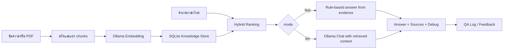

# Thai RAG API

FastAPI prototype สำหรับถามตอบจากฐานความรู้ภาษาไทยบนเครื่อง ใช้ Ollama สร้าง embeddings สำหรับค้นเอกสารแบบ hybrid และเลือกตอบด้วยกฎที่ตรวจสอบได้หรือ local LLM พร้อมคืนแหล่งอ้างอิง

> สถานะ: ต้นแบบสำหรับ local development ใช้ SQLite และ Ollama ยังไม่ใช่บริการ production และไม่มีผล benchmark ที่ยืนยันความแม่นยำใน repository

## ความสามารถที่ตรวจสอบได้จากโค้ด

- เพิ่มความรู้จากข้อความหรือ PDF ที่มี selectable text
- แบ่งเอกสารเป็น chunks และเก็บ embeddings ใน SQLite
- จัดอันดับด้วย semantic similarity, keyword score และ category boost
- โหมด `fast` ตอบด้วยกฎจากหลักฐานที่ค้นได้
- โหมด `llm` ส่ง context ที่ค้นได้ให้ local chat model ผ่าน Ollama
- คืน source metadata, intent, เวลา และ debug scores ใน response
- เก็บ QA logs และ feedback
- มี batch test endpoint สำหรับคำถามไม่เกิน 30 ข้อต่อครั้ง
- มีหน้าเว็บตัวอย่างและ Swagger UI

ทั้งโหมด `fast` และ `llm` ต้องใช้ embedding model ผ่าน Ollama ส่วน chat model ถูกเรียกเฉพาะโหมด `llm`

## Workflow



## เทคโนโลยี

- Python และ FastAPI
- SQLite
- Ollama HTTP API
- `bge-m3` เป็น embedding model เริ่มต้น
- `qwen3.5:9b-q4_K_M` เป็น chat model เริ่มต้น
- `pdfplumber` สำหรับ PDF ที่มีชั้นข้อความ

## ติดตั้งบนเครื่อง

### 1. เตรียม Ollama

```powershell
ollama pull bge-m3
ollama pull qwen3.5:9b-q4_K_M
ollama list
```

หากเปลี่ยนชื่อโมเดล ให้ตั้ง `EMBED_MODEL` หรือ `CHAT_MODEL` ให้ตรงกับโมเดลที่มีจริงในเครื่อง

### 2. เตรียม Python environment

```powershell
git clone https://github.com/BossZY27/thai-rag-api.git
cd thai-rag-api
python -m venv .venv
.\.venv\Scripts\Activate.ps1
python -m pip install -r requirements.txt
```

### 3. ตั้ง environment variables

โค้ดอ่านค่าจาก process environment โดยตรง ไฟล์ `.env.example` เป็นรายการอ้างอิงและไม่ได้ถูกโหลดอัตโนมัติในโค้ดปัจจุบัน สำหรับ PowerShell ให้ตั้งค่าใน session ที่จะรัน API:

```powershell
$env:OLLAMA_URL = "http://127.0.0.1:11434"
$env:CHAT_MODEL = "qwen3.5:9b-q4_K_M"
$env:EMBED_MODEL = "bge-m3"
$env:RAG_API_KEY = "replace_with_a_long_random_value"
$env:MAX_CONTEXT_CHARS = "5200"
$env:MAX_ANSWER_TOKENS = "360"
$env:OLLAMA_KEEP_ALIVE = "10m"
```

| ตัวแปร | ค่าเริ่มต้น | หน้าที่ |
|---|---|---|
| `OLLAMA_URL` | `http://127.0.0.1:11434` | Ollama server |
| `CHAT_MODEL` | `qwen3.5:9b-q4_K_M` | โมเดลสำหรับ `mode=llm` |
| `EMBED_MODEL` | `bge-m3` | โมเดลค้นเอกสาร |
| `RAG_API_KEY` | ว่าง | ตรวจ header `x-api-key` เมื่อกำหนดค่า |
| `MAX_CONTEXT_CHARS` | `5200` | จำกัดข้อความ context |
| `MAX_ANSWER_TOKENS` | `360` | จำกัดผลตอบจาก chat model |
| `OLLAMA_KEEP_ALIVE` | `10m` | เวลาคงโมเดลไว้ใน Ollama |

หาก `RAG_API_KEY` ว่าง route ที่มี dependency จะไม่บังคับ key ซึ่งเหมาะเฉพาะการทดลองบนเครื่อง ห้ามเปิด service ออกสู่เครือข่ายโดยไม่มีการป้องกัน

### 4. เริ่ม API

```powershell
python -m uvicorn app.main:app --reload --host 127.0.0.1 --port 8000
```

เปิด:

- Web client: `http://127.0.0.1:8000/`
- Swagger UI: `http://127.0.0.1:8000/docs`
- Health check: `http://127.0.0.1:8000/health`

## เพิ่มข้อมูลสังเคราะห์

ตัวอย่างนี้ใช้ข้อมูลสมมติและไม่มีข้อมูลลูกค้าหรือเอกสารจริง:

```powershell
curl.exe -X POST "http://127.0.0.1:8000/knowledge/text" `
  -H "Content-Type: application/json" `
  -H "x-api-key: replace_with_a_long_random_value" `
  -d '{"title":"คู่มือทดลอง","source_ref":"demo:manual:1","text":"ระบบรับคำขอวันจันทร์ถึงวันศุกร์ เวลา 09:00 ถึง 16:00 น.","category":"process"}'
```

หากไม่ได้ตั้ง `RAG_API_KEY` ให้ตัด header `x-api-key` ออก

## ถามคำถาม

```powershell
curl.exe -X POST "http://127.0.0.1:8000/chat" `
  -H "Content-Type: application/json" `
  -H "x-api-key: replace_with_a_long_random_value" `
  -d '{"question":"ระบบรับคำขอวันไหนและเวลาใด","mode":"fast","top_k":8}'
```

ตัวอย่างโครงสร้าง response ต่อไปนี้เป็นข้อมูลสังเคราะห์ ไม่ใช่ผล benchmark:

```json
{
  "answer": "[คำตอบที่สร้างจากหลักฐานที่ค้นพบ]",
  "sources": [
    {
      "document_id": "demo-id",
      "title": "คู่มือทดลอง",
      "page": 1,
      "category": "process",
      "score": 0.0
    }
  ],
  "elapsed_ms": 0,
  "log_id": 1,
  "intent": "process",
  "debug": {}
}
```

ค่าตัวเลขเป็น placeholder เพื่อแสดงชนิดข้อมูลเท่านั้น ผลจริงขึ้นกับเครื่อง โมเดล และฐานความรู้

## โหลด PDF

ผ่าน API:

```powershell
curl.exe -X POST "http://127.0.0.1:8000/documents/upload" `
  -H "x-api-key: replace_with_a_long_random_value" `
  -F "file=@C:\path\to\document.pdf"
```

หรือสคริปต์ admin จาก root ของ repository:

```powershell
python scripts/load_pdf.py "C:\path\to\document.pdf"
```

สคริปต์ตรวจว่าไฟล์มีอยู่และเป็น `.pdf` ก่อนเรียกตัวสกัดข้อความ หาก PDF เป็นภาพสแกนและไม่มี selectable text ระบบจะหยุดพร้อมข้อความว่าต้อง OCR ก่อน

## API สำคัญ

| Method | Endpoint | หน้าที่ |
|---|---|---|
| `GET` | `/health` | แสดงค่าบริการที่ใช้อยู่ |
| `GET` | `/documents` | รายการเอกสาร |
| `GET` | `/categories` | หมวดหมู่และจำนวน chunks |
| `GET` | `/debug/search` | ตรวจผลจัดอันดับ |
| `POST` | `/knowledge/text` | เพิ่มข้อความเข้าฐานความรู้ |
| `POST` | `/documents/upload` | เพิ่ม PDF |
| `DELETE` | `/documents/{document_id}` | ลบเอกสารและ chunks |
| `POST` | `/chat` | ถามคำถามด้วย `fast` หรือ `llm` mode |
| `POST` | `/feedback` | บันทึก feedback |
| `GET` | `/logs` | อ่าน QA logs |
| `POST` | `/test/batch` | ทดสอบคำถามเป็นชุด |

## ตรวจคุณภาพแบบไม่เรียก Ollama

```powershell
python -m compileall app scripts
```

การทดสอบ ingest และ `/chat` เป็น integration test เพราะเรียก Ollama จึงไม่ได้รวมใน static check นี้

## ข้อจำกัดและความปลอดภัย

- SQLite และ API key เดียวเหมาะกับ prototype ไม่ใช่ multi-tenant production
- embeddings ถูกเก็บเป็น JSON ใน SQLite จึงไม่เหมาะกับฐานข้อมูลขนาดใหญ่
- PDF แบบสแกนต้องผ่าน OCR ก่อน
- `/health` เปิดเผย path ฐานข้อมูลและชื่อโมเดล จึงไม่ควรเปิด public โดยไม่มี reverse proxy/access control
- debug, logs และ source snippets อาจมีเนื้อหาเอกสาร ควรกำหนด retention และสิทธิ์ก่อนใช้ข้อมูลจริง
- ห้าม commit `.env`, `data/`, เอกสารจริง หรือ API key ขึ้น repository
